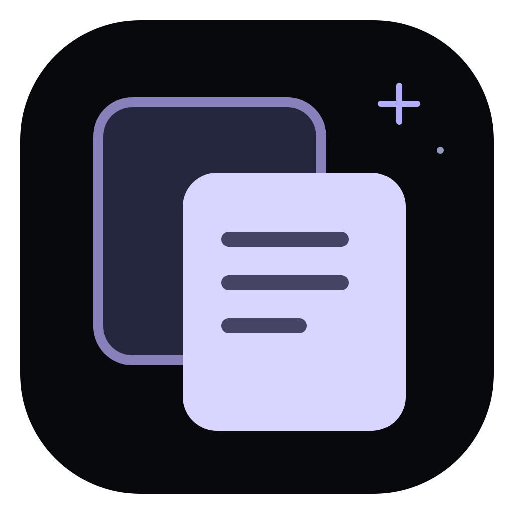
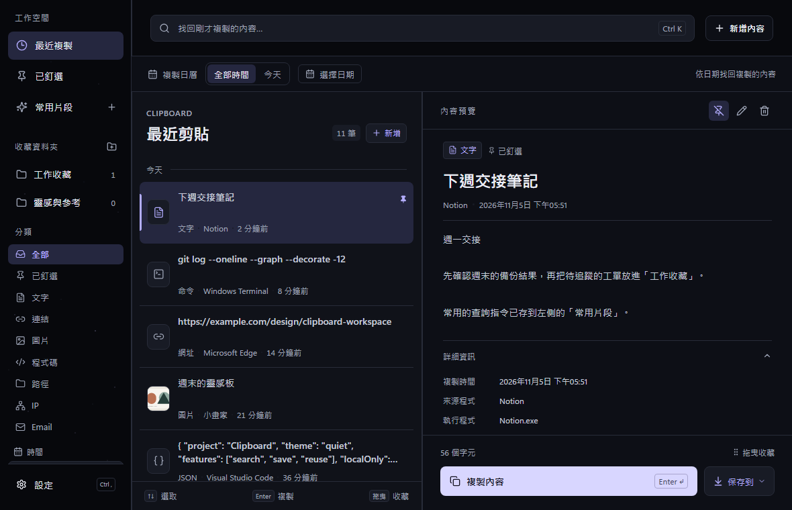
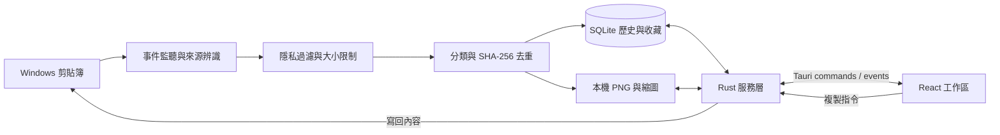

<p align="center">
  
</p>

<h1 align="center">剪貼後台 · Clarity Clipboard</h1>

<p align="center"><strong>複製一次，隨時找回。把零散內容，整理成自己的工作記憶。</strong></p>

<p align="center">
  <a href="https://github.com/tigerhzu/clarity-clipboard/releases/latest"></a>
  
  
  <a href="LICENSE"></a>
</p>

<p align="center">
  <a href="https://github.com/tigerhzu/clarity-clipboard/releases/latest">下載安裝</a> ·
  <a href="#三個工作區">功能介紹</a> ·
  <a href="docs/ARCHITECTURE.md">架構與資料流</a> ·
  <a href="docs/DEVELOPMENT.md">開發指南</a> ·
  <a href="docs/CHANGELOG.md">更新紀錄</a>
</p>

<picture>
  <source media="(prefers-reduced-motion: reduce)" srcset="docs/assets/hero-static.svg">
  
</picture>

Clarity 是 Windows 的本機剪貼簿工作區。文字、連結、程式碼與圖片在背景擷取，隨時用 `Alt + Z` 叫出搜尋；重要內容可以釘選、收進資料夾，或整理成可重複使用的個人片段。安裝後在 Windows 顯示為「剪貼後台」，視窗標題為「剪貼 · Clarity」。

複製日曆會點亮有保留紀錄的日期，選取後可搭配分類與搜尋查看當天內容，也能一鍵切回全部時間。後台同一時間只啟用一個，重複開啟會喚回既有視窗。

核心擷取、分類與搜尋在電腦本機完成，不需要帳號、AI API 或雲端服務。深色三欄介面以銀白文字與紫色焦點呈現內容，讓搜尋、選取與閱讀各有位置。



<p align="center"><sub>實際前端介面，使用隔離的合成示範資料。</sub></p>

## 三個工作區

| 工作區 | 用來做什麼 | 主要操作 |
| --- | --- | --- |
| 最近複製 | 找回稍早複製的內容 | 即時搜尋、內容與時間篩選、釘選、複製、確認刪除 |
| 收藏資料夾 | 依工作或主題保存快照 | 拖曳收藏、選擇儲存目的地、重新命名、編輯內容、拖曳排序 |
| 常用片段（個人資料庫） | 保存常用回覆、指令與片段 | 新增標題與內容、編輯、複製、從歷史加入、拖曳排序 |

所有工作區都可按「新增內容」或 `Ctrl + N` 手動新增，並在預覽按鉛筆編輯標題、內容與類型。圖片可匯入或替換 PNG、JPEG、BMP（20 MB 以下）；收藏資料夾可直接建立常用語句。

### 把找到內容的時間縮短

- **自動分類**：文字、URL、Email、IP、檔案／網路路徑、程式碼、JSON、指令與圖片；JSON 和指令歸入介面的「程式碼」篩選。
- **本機搜尋**：SQLite FTS5 全文索引加上部分字串比對，可搜尋內容、來源應用程式、類型與標籤。
- **圖片閱讀**：保存 PNG 與縮圖，按需載入預覽，點圖片可展開符合視窗比例的放大檢視。
- **背景常駐**：關閉視窗後隱藏至通知區，仍持續監聽剪貼簿；可用通知區選單結束程式。
- **閱讀舒適度**：標準、舒適、大字三種文字大小，預設舒適；支援最小 900 × 600 視窗。
- **保留策略**：7、14、30 天或永久保存；釘選歷史與收藏快照不受一般歷史到期清理影響。

## 開始使用

1. 前往 [GitHub Releases](https://github.com/tigerhzu/clarity-clipboard/releases/latest)，下載 `Clarity-Setup.exe`。
2. 執行安裝程式。它會安裝至目前 Windows 使用者、建立捷徑，完成後開啟 Clarity。
3. 複製一段文字或圖片，按 `Alt + Z` 開啟工作區。搜尋、雙擊項目即可再次複製。
4. 在「設定 → 隱私」調整排除應用程式；在儲存設定選擇歷史保留天數。

目前發行目標為 **Windows x64**。桌面介面使用 Microsoft Edge WebView2；已有執行環境時直接使用，缺少時安裝程式會透過網路下載補齊。未簽章的建置可能在 Windows 顯示未知發行者提示，下載來源與檔案雜湊請以本倉庫的 Release 為準。

升級時直接執行新版安裝程式。快速安裝器會先要求正在執行的 Clarity 結束，再更新程式。本機資料目錄識別碼維持不變；如需自行備份，先從通知區完整結束 Clarity，再複製整個[資料目錄](#資料保存在你的電腦)。

### 鍵盤操作

| 快捷鍵 | 操作 |
| --- | --- |
| `Alt + Z` | 顯示／隱藏工作區，可在設定修改 |
| `Ctrl + K` / `Ctrl + F` | 聚焦搜尋 |
| `↑` / `↓` | 移動歷史清單選取 |
| `Enter` | 複製選取內容（依目前焦點情境） |
| `Ctrl + P` | 切換歷史項目釘選 |
| `Delete` | 進入刪除確認 |
| `Ctrl + N` | 在目前工作區新增文字或圖片 |
| `Ctrl + ,` | 開啟設定 |

## 架構一覽



| 層級 | 技術 | 責任 |
| --- | --- | --- |
| 使用介面 | React 19、TypeScript 5.9、Lucide React、CSS | 搜尋、清單、預覽、收藏與設定 |
| 前端建置 | Vite 7、pnpm | 開發伺服器、型別檢查、靜態資產 |
| 桌面邊界 | Tauri 2、WebView2、global-shortcut | 視窗、通知區、全域快捷鍵、前後端命令 |
| 本機核心 | Rust 2021、clipboard-win、windows-sys | 剪貼簿事件、來源辨識、分類、隱私檢查 |
| 保存與搜尋 | rusqlite + bundled SQLite、WAL、FTS5 | 歷史、資料夾、個人片段、交易與索引 |
| 圖片與識別 | image、SHA-256、UUID | PNG／縮圖、內容指紋、項目識別 |
| Windows 發行 | Tauri NSIS、C# WinForms 快速安裝器 | 使用者層級安裝、升級與捷徑 |

深入了解：[系統架構、資料表與隱私界線](docs/ARCHITECTURE.md)。

## 資料保存在你的電腦

```text
%APPDATA%\com.tigerhzu.clarityclipboard\
├── clipboard.db              # 歷史、收藏資料夾、個人片段：同一個 SQLite 資料庫
├── settings.json             # 保留天數、隱私、文字大小與快捷鍵
└── images\                   # 歷史圖片 PNG
    ├── thumbnails\           # 歷史縮圖
    └── collections\          # 收藏的獨立圖片快照
        └── thumbnails\
```

應用程式沒有帳號、遙測或雲端同步，核心不直接呼叫外部 AI。選擇啟用 [Hermes 串接](docs/HERMES.md) 後，本機代理可以依你的要求讀寫指定內容，並可能將取用的文字／圖片送往它設定的模型服務。首頁徽章和 GitHub 下載頁屬於文件／發行服務，安裝 WebView2 可能連網；這些與剪貼簿內容處理分開。

敏感內容過濾預設啟用，使用規則辨識常見 token、私鑰、帶標籤密碼與符合 Luhn 校驗的卡號；預設排除 1Password、Bitwarden、KeePass、KeePassXC 與遠端桌面。它不是完整防洩漏系統：未符合規則的文字或圖片仍可能被保存，手動建立片段也不經自動擷取過濾。資料庫與圖片沒有應用程式層加密，應以 Windows 帳戶與磁碟保護妥善管理。

<details>
<summary><strong>開發與驗證快速入口</strong></summary>

需準備 Node.js、pnpm、Rust MSVC 工具鏈、Visual Studio C++ Build Tools 與 WebView2。以 `package.json` 的 `packageManager` 和鎖定檔為準。

```powershell
pnpm install --frozen-lockfile
pnpm tauri dev
```

```powershell
pnpm build
cargo fmt --manifest-path src-tauri/Cargo.toml --check
cargo check --manifest-path src-tauri/Cargo.toml --locked
cargo test --manifest-path src-tauri/Cargo.toml --locked
pnpm package:quick
```

Playwright 介面測試使用隔離的假資料，不會讀取真實剪貼簿。完整環境、測試方式與建置指令見 [開發指南](docs/DEVELOPMENT.md)；產物與發行步驟見 [Release 指南](docs/RELEASE.md)。

</details>

## Tiger Hsu 工具集

| 專案 | 使用場景 |
| --- | --- |
| [Freedom Wiki Assistant](https://github.com/tigerhzu/freedom-wiki-assistant) | Wiki 工作與知識整理輔助 |
| [HaloPSA Extension](https://github.com/tigerhzu/halo-psa-extension) | HaloPSA 工作流程輔助 |
| **Clarity Clipboard** | Windows 本機剪貼簿搜尋與收藏 |

三個專案各自安裝與運作，沒有隱含的跨工具資料同步。

整體資料流與技術比較見 [三個工具的架構全景](docs/TOOLKIT.md)。

由 Tiger Hsu 維護，採 [MIT 授權](LICENSE)。設計規格見 [DESIGN.md](DESIGN.md)；問題與功能建議可提交至 [Issues](https://github.com/tigerhzu/clarity-clipboard/issues)。

## 設計素材

[Logo SVG](docs/assets/logo.svg) · [Logo PNG](docs/assets/logo.png) · [動態封面](docs/assets/hero.svg) · [靜態封面](docs/assets/hero-static.svg) · [架構圖 SVG](docs/assets/architecture.svg) · [品牌配色](docs/assets/brand.json)。首頁動畫尊重減少動態效果偏好。
