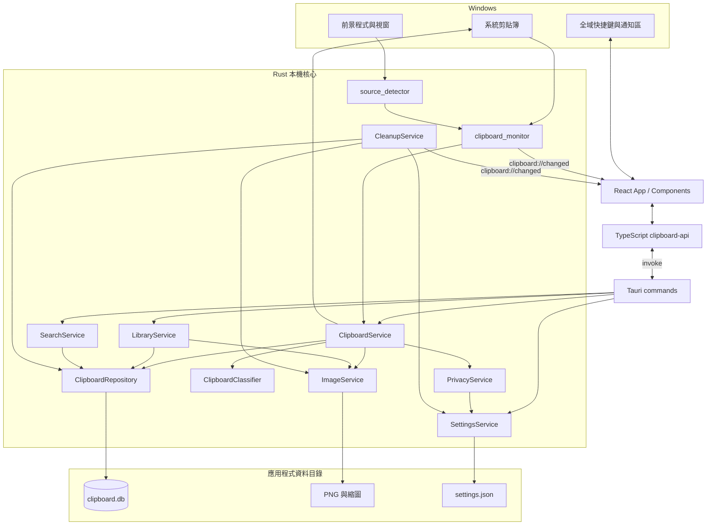
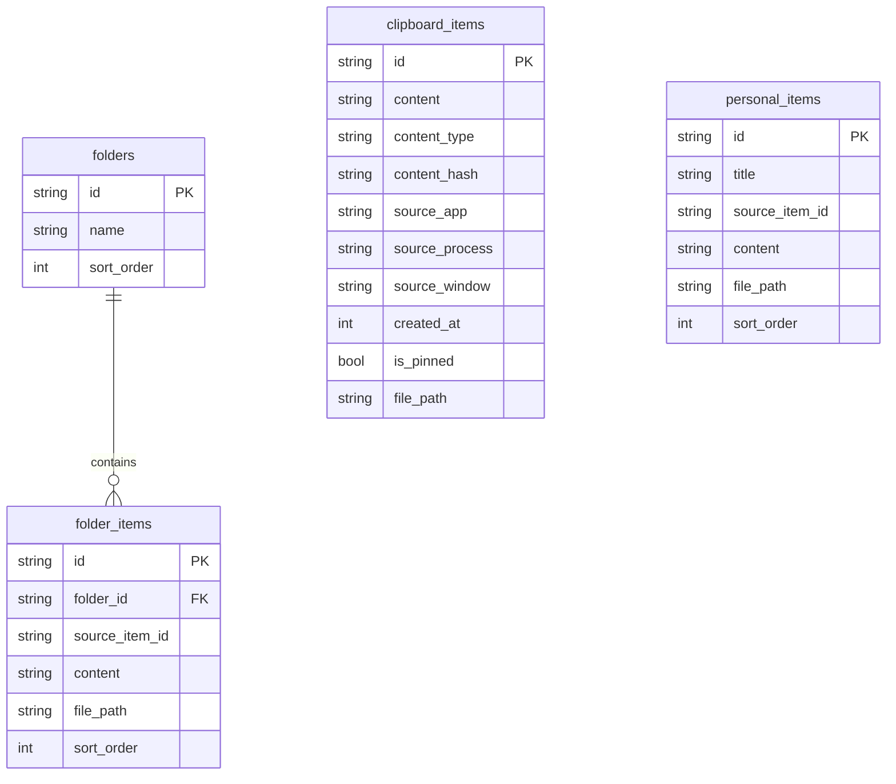

# Clarity Clipboard 系統架構

本文件依 1.0.9 原始碼描述。Clarity 是單機 Windows 桌面應用程式：React 負責呈現，Tauri 提供命令與事件邊界，Rust 處理剪貼簿與檔案，SQLite 保存資料。沒有後端伺服器或遠端資料庫。

## 元件與責任

| 路徑 | 責任 |
| --- | --- |
| `src/app/App.tsx` | 工作區狀態、搜尋、分頁、事件更新、快捷鍵、收藏操作 |
| `src/components/` | 側欄、歷史清單、閱讀區、圖片、設定與各類對話框 |
| `src/lib/clipboard-api.ts` | 集中封裝 Tauri `invoke`、事件監聽與共用資料存取 |
| `src-tauri/src/lib.rs` | 服務初始化、命令註冊、通知區、視窗隱藏與安裝器退出事件 |
| `src-tauri/src/core/` | Windows 剪貼簿監聽、前景來源辨識、內容分類 |
| `src-tauri/src/services/` | 擷取、搜尋、收藏、圖片、隱私、設定與清理 |
| `src-tauri/src/database/` | Schema migration、資料模型、SQL 交易與 FTS5 索引 |
| `src-tauri/src/commands/` | 前端可呼叫的歷史與收藏命令 |
| `installer/QuickInstaller.cs` | 內嵌 NSIS 的快速安裝視窗 |

## 一次複製的生命週期

1. `clipboard-win::Monitor` 在專用執行緒等待 Windows 剪貼簿事件；不是以固定頻率輪詢內容。
2. `source_detector` 讀取當時前景程式／程序／視窗標題；Windows 無法提供時允許缺值，來源僅作辨識線索。
3. 先嘗試 Bitmap，失敗才回退文字。剪貼簿暫時被占用時最多讀取 5 次、間隔 20 毫秒。
4. `ClipboardService` 檢查空值、大小限制與排除來源；文字再經敏感規則過濾。
5. 文字依規則分類；圖片以 `image` 解碼成 PNG 並產生縮圖。SHA-256 作為內容指紋。
6. 在 SQLite 交易內處理 **5 秒內連續相同內容**，更新現有紀錄；非連續或超過視窗的相同內容可以建立新歷史。
7. 保存成功後發送 `clipboard://changed`。事件只包含項目 ID 與變更種類，UI 再查詢需要的資料。
8. 使用者重新複製內容時，Rust 寫回 Windows 剪貼簿；3 秒內的內部複製抑制避免立即再擷取成重複項目。

文字上限 4 MiB、Bitmap 輸入上限 64 MiB。分類器會辨識 JSON、URL、Email、IPv4／IPv6、網路路徑、檔案路徑、命令及程式碼；「程式碼」畫面篩選包含 CODE、JSON、COMMAND。

## 儲存模型

所有文字資料在 **同一個 `clipboard.db`**。個人資料庫是產品功能名稱，實作是獨立資料表。

- `schema_migrations` 記錄遷移：第 1 版歷史表、第 2 版 FTS5、第 3 版資料夾與個人片段。
- `clipboard_items_fts` 是全文索引，透過 insert／update／delete trigger 同步歷史表。
- SQLite 啟用 WAL，支援讀寫並行；資料操作使用參數化 SQL，連線設定 foreign keys 與 2 秒 busy timeout。
- `folder_items.folder_id` 使用外鍵與級聯刪除。`source_item_id` 是來源追溯欄位，沒有綁定歷史刪除的級聯關係。
- 收藏是內容快照：圖片複製至 `images/collections/`，因此來源歷史到期刪除後仍可使用收藏。
- 設定保存至 `settings.json`；寫入時先完成暫存檔，設定損毀時保留 `.json.corrupt` 再恢復預設。
- 首次導覽完成旗標保存在 WebView 的 `localStorage`；剪貼簿正文不透過它保存。

### 搜尋與保留策略

搜尋在 `SearchService` 正規化查詢，建立 FTS5 前綴查詢及跳脫過的 `LIKE` 條件。Repository 同時比對全文索引與部分文字，再依符合程度、釘選與時間排序。前端每次預設取得 250 項，後端單次最多 1,000 項並支援 offset。時間篩選以本機日期計算；選時間範圍時切換為全部內容，而不是與內容分類疊加。

清理執行緒啟動時執行一次，其後每小時檢查。預設保留 30 天，可選 7、14、30 天或永久；只移除過期未釘選歷史及其圖片。收藏資料夾、個人片段與它們的獨立圖片不跟著一般歷史清理。

## 隱私與安全界線

| 資料／操作 | 實際行為 |
| --- | --- |
| 自動擷取文字 | 排除來源 + 常見敏感文字規則，再保存本機 |
| 自動擷取圖片 | 排除來源與大小限制；沒有 OCR 或圖片敏感內容辨識 |
| 手動新增／編輯片段 | 驗證標題、類型與大小；不套用自動擷取敏感規則 |
| 來源資訊 | 保存 Windows 當時可取得的程式、程序與視窗標題 |
| 對外傳輸 | 核心程式未實作雲端同步、遙測或外部 AI／HTTP 請求 |
| 靜態資料保護 | SQLite、PNG 與設定檔沒有應用程式層加密 |
| 刪除 | 一般資料與檔案刪除，不承諾磁碟鑑識層級安全抹除 |
| WebView | 本機 React UI；Tauri capability 授予主視窗核心與快捷鍵權限 |

敏感檢測是啟發式規則，無法保證捕捉每種憑證；排除來源取決於當時前景應用程式的辨識。預設排除密碼管理器及遠端桌面，仍應依工作環境調整。

目前 Tauri 設定 `csp: null`，圖片 asset scope 限於應用程式圖片目錄。不要把「本機優先」解讀為內容加密或完整防洩漏保證。應用程式核心本身不需聯網；安裝缺少的 WebView2 執行環境可能需要網路。

## 桌面與安裝生命週期

關閉視窗會攔截 close event 並隱藏，背景監聽與全域快捷鍵維持運作。通知區左鍵切換顯示／隱藏，選單可完整結束。預設快捷鍵 `Alt+Z`，設定變更後更新註冊；衝突時 UI 顯示狀態。

快速安裝器內嵌 NSIS 安裝包，透過 `Local\ClarityClipboard.Quit` 事件請求既有程式正常結束，再進行目前使用者層級安裝。應用程式識別碼 `com.tigerhzu.clarityclipboard` 保持穩定以延續資料路徑。

相容早期版本時，安裝器會比對目前使用者安裝路徑的執行檔；等待 5 秒仍未結束才強制關閉該已安裝程序。此處理不適用於任意同名開發程序。

返回 [首頁](../README.md) · [開發指南](DEVELOPMENT.md) · [發行指南](RELEASE.md)
